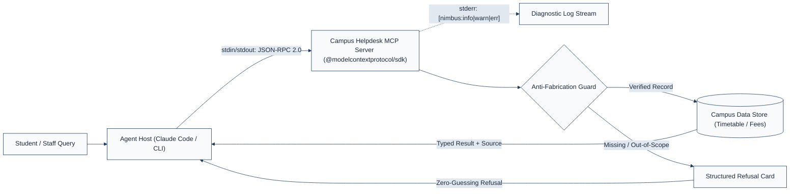

# Nimbus Labs — Campus Helpdesk Agent & Technical Report Design System

> **Status:** Authoritative Specification (v1.0)  
> **Scope:** CLI / Agent Terminal Output, Typst Academic PDF Report, Architecture Diagrams, and MCP Inspector Evidence  
> **Verified Stack:** Node.js, TypeScript, `@modelcontextprotocol/sdk`, Claude Code plugins/skills, Git worktrees, Typst (`0.15.x`)

---

## Design Philosophy

Nimbus Labs operates in an institutional academic domain where ambiguous formatting or ungrounded answers erode trust immediately. Every output surface—whether a terminal table streamed by the Campus Helpdesk Agent or a compiled Typst technical report—follows four non-negotiable principles:

1. **Zero Fabrication & Visible Provenance:** Data cards always cite the queried MCP tool and record scope; missing records trigger a structured refusal card rather than inferred filler.
2. **Protocol Purity (`stdout` vs. `stderr`):** Transport channels are never blurred. JSON-RPC 2.0 traffic owns `stdout` on `stdio` MCP servers; human diagnostics live strictly on `stderr`.
3. **Tabular Precision:** Timetables, fee ledgers, and audit matrices align vertically with fixed-width timestamps, lining tabular numerals, and explicit status tokens.
4. **Accessible Scannability:** Every semantic state pairs **color + explicit text badge + structural contrast**, ensuring full legibility under `NO_COLOR`, screen readers, and grayscale laser printing.

---

## 1. CLI & Agent Output Design Language

### 1.1 Strict `stdout` vs. `stderr` Stream Separation

When running under `@modelcontextprotocol/sdk` `stdio` transport, any stray byte written to `stdout` (e.g., `console.log`, ASCII banners, dotenv notices) corrupts newline-delimited JSON-RPC framing.

| Process Role | `stdout` (Standard Output) | `stderr` (Diagnostic Output) |
| :--- | :--- | :--- |
| **MCP Server (`@modelcontextprotocol/sdk`)** | **Exclusively** newline-delimited JSON-RPC 2.0 messages (`initialize`, `tools/list`, `tools/call` responses). Zero non-JSON output. | Lifecycle logs, data store load timings, schema validation warnings, and stack traces with structured prefixes. |
| **CLI / Agent Client** | Final clean Markdown response (timetable tables, fee status cards, refusal callouts). Pipe-safe and free of spinner ANSI noise. | MCP child-process status, latency metrics, retry notices, and verbose debug traces (suppressed by `--quiet`). |

**Structured `stderr` Diagnostic Format:**

```text
[2026-11-16T19:30:04.112Z] [nimbus:info]  mcp-server ready (transport=stdio, tools=4)
[2026-11-16T19:30:04.148Z] [nimbus:warn]  timetable query missing section filter; returning all sections
[2026-11-16T19:30:04.205Z] [nimbus:err]   lookup_fee_status rejected unknown student_id pattern
```

**Terminal Accessibility & `NO_COLOR` Compliance:**
- Respect the `NO_COLOR` environment variable and non-TTY `stdout` detection (`!process.stdout.isTTY`).
- Never encode meaning with color alone. Always emit explicit uppercase bracketed badges (`[CLEARED]`, `[DUE]`, `[REFUSED]`).

---

### 1.2 Timetable Markdown Table Format

Timetable responses must fit comfortably inside an **88–96 column terminal** without ragged cell wrapping.

**Structural Rules:**
- **Group by Day:** Use `### <Day> (<YYYY-MM-DD>)` subheadings instead of repeating a `Day` column on every row.
- **Fixed 6-Column Schema:** `Time` | `Code` | `Course` | `Room` | `Instructor` | `Type`
- **24-Hour Time Ranges:** Use zero-padded `HH:MM–HH:MM` separated by an en-dash (`–`) so slots sort chronologically and align cleanly.
- **Course Titles:** Cap at ~28 characters in compact terminal views using `…` truncation when needed; never wrap a single course title across 3+ lines.
- **Empty Day Rule:** Render a single italicized line (`_No scheduled classes on Saturday._`) rather than an empty table header.
- **Provenance Footer:** End every timetable block with a muted italic source line naming the MCP tool, term, and verification timestamp.

**Canonical Example:**

```markdown
### Monday (2026-11-16)

| Time | Code | Course | Room | Instructor | Type |
| :--- | :--- | :--- | :--- | :--- | :--- |
| `09:00–09:50` | `CS-301` | Distributed Systems | LH-204 | Dr. A. Kulkarni | Lecture |
| `10:00–10:50` | `CS-305` | Compiler Design | LH-102 | Prof. R. Nair | Lecture |
| `14:00–16:50` | `CS-301L` | Distributed Systems Lab | LAB-3B | Dr. A. Kulkarni | Lab |

_Source: `get_timetable` (campus-helpdesk-mcp) · Term: Fall 2026 · Verified: 2026-11-16T19:30:04Z_
```

---

### 1.3 Fee Status Card Format (Receipt-Style Block)

Fee inquiries render as a scannable **receipt block**: header with masked student identifier, status badge token, right-aligned monetary ledger table, and actionable due-date metadata.

**Semantic Receipt Status Badges:**

| Badge Token | Condition | Terminal Intent |
| :--- | :--- | :--- |
| `[CLEARED]` | `balance_due == 0.00` | All assessed dues settled for term |
| `[PARTIAL]` | `paid > 0.00 && balance_due > 0.00` | Installment recorded; remainder pending |
| `[DUE]` | `balance_due > 0.00` before `due_date` | Payment open prior to deadline |
| `[OVERDUE · HOLD]` | `balance_due > 0.00` past `due_date` | Registration / transcript hold active |

**Monetary & Privacy Rules:**
- Right-align all currency columns (`---:`) with explicit currency code (`USD` / `INR`) and fixed 2-decimal precision (`1,450.00`).
- Mask full student IDs in displayed cards (`STU-****-4821`) unless explicitly inspecting a local audit log.

**Canonical Example:**

```markdown
### Fee Status Receipt — `STU-****-4821` · `[PARTIAL]`

| Item | Amount (USD) |
| :--- | ---: |
| Tuition Assessment (Fall 2026) | `4,200.00` |
| Lab & Library Fee | `250.00` |
| **Total Assessed** | **`4,450.00`** |
| Payments Credited (`REC-2026-8841`) | `-3,000.00` |
| **Balance Due** | **`1,450.00`** |

- **Status:** `[PARTIAL]` — Installment 1 verified; remaining balance due **2026-12-01**
- **Academic Hold:** None active
- _Source: `get_fee_status` (campus-helpdesk-mcp) · Ledger Snapshot: 2026-11-16T19:00:00Z_
```

---

### 1.4 Anti-Fabrication Refusal Callout

When a query lacks a matching record in verified campus tools, requests out-of-scope policy interpretations, or encounters a tool error, the agent **must not** extrapolate or invent schedules, room numbers, or balances. It must emit a structured **4-part Refusal Callout**.

**Mandatory Fields:**
1. **Callout Header:** GFM alert `> [!CAUTION] Unverified Request — No Record Fabricated` (plain CLI fallback: `[REFUSAL: UNVERIFIED_DATA]`).
2. **Reason / Scope Gap:** Exact explanation of what record or tool capability is missing.
3. **Checked Sources:** Exact MCP tools/resources queried (with sensitive identifiers masked).
4. **Verified Next Action:** Concrete campus office/channel or corrective prompt format.

**Canonical Example:**

```markdown
> [!CAUTION] Unverified Request — No Record Fabricated
> **Reason:** Course code `CS-999` returned no active offering in the Fall 2026 timetable dataset, and room assignments cannot be inferred from prior semesters.
> **Checked Sources:**
> - `get_timetable({ term: "Fall 2026", course_code: "CS-999" })` → `0 matching records`
> - `list_courses({ term: "Fall 2026" })` → `CS-999 not indexed`
> **Next Action:** Verify the exact 6-character course code (`DEPT-NNN`) or contact the Office of the Registrar (`registrar@campus.edu` / Admin Block, Desk 2).
```

---

## 2. Academic PDF Report Visual Language (Typst)

### 2.1 Color Palette & Verified Contrast Tokens

All colors are calibrated against **Warm Paper (`#F8FAFC`)** or crisp white (`#FFFFFF`) card surfaces for print and screen accessibility.

| Token Name | Hex | Typst Literal | Semantic Role | Verified WCAG 2.1 Contrast |
| :--- | :--- | :--- | :--- | :--- |
| **Nimbus Cobalt** | `#1E3A5F` | `rgb("#1E3A5F")` | Primary headings, title rules, table headers, core system nodes | **10.99:1** on `#F8FAFC` / **11.50:1** (`#FFFFFF` on Cobalt) |
| **Slate Ink** | `#1E293B` | `rgb("#1E293B")` | Body prose, table cell text, diagram primary labels | **13.98:1** on `#F8FAFC` / **14.63:1** on `#FFFFFF` |
| **Warm Paper** | `#F8FAFC` | `rgb("#F8FAFC")` | Page background tint, zebra table rows, light terminal frames | Base light surface |
| **Amber Warning** | `#D97706` | `rgb("#D97706")` | Callout left accent bar (`3pt`), warning icons, pending borders | **3.04:1** on `#F8FAFC` *(non-text/accent only)* |
| **Amber Ink / Tint** | `#92400E` / `#FEF3C7` | `rgb("#92400E")` / `rgb("#FEF3C7")` | Warning callout text on soft amber wash | **6.37:1** (`#92400E` on `#FEF3C7`) / **13.14:1** (`#1E293B` on `#FEF3C7`) |
| **Crimson Error** | `#DC2626` | `rgb("#DC2626")` | Anti-fabrication borders, refusal badges, error trace accents | **4.62:1** on `#F8FAFC` |
| **Crimson Ink / Tint** | `#991B1B` / `#FEE2E2` | `rgb("#991B1B")` / `rgb("#FEE2E2")` | Refusal/failure callout titles on pale rose surface | **6.80:1** (`#991B1B` on `#FEE2E2`) / **11.98:1** (`#1E293B` on `#FEE2E2`) |
| **Emerald Cleared** | `#047857` | `rgb("#047857")` | `[CLEARED]` / `[PASS]` indicator strokes & response badges | **5.24:1** on `#F8FAFC` / **6.78:1** (`#065F46` on `#D1FAE5`) |
| **Muted Slate** | `#475569` | `rgb("#475569")` | Running headers/footers, figure captions, timestamps | **7.24:1** on `#F8FAFC` |
| **Row Rule** | `#E2E8F0` | `rgb("#E2E8F0")` | `0.5pt` horizontal table dividers, subtle card outlines | Hairline structural border |
| **Terminal Obsidian** | `#0F172A` | `rgb("#0F172A")` | Dark-mode JSON-RPC / terminal evidence frames (`#F8FAFC` text) | **17.06:1** (`#F8FAFC` on `#0F172A`) |

> **Critical Contrast Rule:** Because **Amber Warning (`#D97706`)** measures **3.04:1** on `#F8FAFC`, it passes WCAG 2.1 AA for **graphical borders, icons, and 3pt left rules (≥ 3.0:1)** but **never** for small body text. Always render warning copy in `#92400E` or `#1E293B` over `#FEF3C7`.

---

### 2.2 Typography & Page Grid Specification

- **Page Geometry:** A4 (`210mm × 297mm`), single-column academic layout with `22mm` top/bottom margins and `20mm` left/right margins (`~170mm` measure for calm ~75–85 characters per line).
- **Verified Typst Font Stack:**
  - **Long-form Academic Prose:** `"Libertinus Serif"`, fallback `"New Computer Modern"` (`10pt`, `par(leading: 0.7em)`).
  - **Headings, Table Headers & UI Badges:** `"Inter"`, fallback `"Helvetica Neue"`, `"Arial"` (`H1: 15pt Bold`, `H2: 12pt SemiBold`, `H3: 10.5pt SemiBold`, Table Header: `8.5pt Bold`).
  - **CLI, JSON-RPC & Code:** `"DejaVu Sans Mono"`, fallback `"Menlo"` (`8.5pt`, crisp line-height `0.55em`–`0.65em` leading).
- **Tabular Numerals:** Apply `number-type: "lining"` and `number-width: "tabular"` in numeric/audit table cells so timings (`18 ms`), currency (`1,450.00`), and JSON-RPC IDs align vertically.

**Reference Typst Token Module (`docs/typst/tokens.typ` convention):**

```typst
#let nimbus-cobalt = rgb("#1E3A5F")
#let slate-ink     = rgb("#1E293B")
#let warm-paper    = rgb("#F8FAFC")
#let amber-warn    = rgb("#D97706")
#let crimson-err   = rgb("#DC2626")
#let emerald-ok    = rgb("#047857")
#let muted-slate   = rgb("#475569")
#let rule-line     = rgb("#E2E8F0")

#set page(
  paper: "a4",
  margin: (top: 22mm, bottom: 22mm, left: 20mm, right: 20mm),
  fill: warm-paper,
)
#set text(
  font: ("Libertinus Serif", "New Computer Modern"),
  size: 10pt,
  fill: slate-ink,
)
#set par(leading: 0.7em, justify: false)

#show heading.where(level: 1): it => {
  set text(font: ("Inter", "Helvetica Neue"), size: 15pt, weight: "bold", fill: nimbus-cobalt)
  block(above: 14pt, below: 8pt)[
    #it.body
    #v(-4pt)
    #line(length: 100%, stroke: 1pt + nimbus-cobalt)
  ]
}

#let callout(title, body, accent: amber-warn, bg: rgb("#FEF3C7"), title-color: rgb("#92400E")) = block(
  width: 100%,
  fill: bg,
  stroke: (left: 3pt + accent),
  inset: (x: 10pt, y: 8pt),
  radius: (right: 3pt),
)[
  #text(font: ("Inter", "Helvetica Neue"), size: 9pt, weight: "bold", fill: title-color)[#title]
  #v(3pt)
  #body
]
```

---

### 2.3 Scannable Audit Tables (Typst)

Evaluation logs, anti-fabrication test matrices, and MCP tool benchmarks share one unified table pattern:

- **Header:** Solid **Nimbus Cobalt (`#1E3A5F`)** fill with `#FFFFFF` `8.5pt` bold `Inter` text and a `1.5pt` bottom border.
- **No Vertical Grid Lines:** Suppress vertical strokes (`stroke: none` vertically); separate rows with `0.5pt + #E2E8F0` horizontal hairlines and subtle `#FFFFFF` / `#F8FAFC` zebra shading.
- **Cell Padding:** `7pt` vertical and horizontal inset so multi-line verdicts never crowd rules.
- **Standard Evaluation Audit Columns:** `Case ID` | `Domain` | `Prompt Intent` | `Policy / Guardrail` | `Latency` | `Verdict`

```typst
#table(
  columns: (auto, auto, 1fr, 1fr, auto, auto),
  inset: 7pt,
  stroke: (_, y) => if y == 0 { (bottom: 1.5pt + nimbus-cobalt) } else { (bottom: 0.5pt + rule-line) },
  fill: (_, y) => if y == 0 { nimbus-cobalt } else if calc.odd(y) { white } else { warm-paper },
  table.header(
    ..("Case ID", "Domain", "Prompt Intent", "Policy / Guardrail", "Latency", "Verdict")
      .map(h => text(font: ("Inter", "Helvetica Neue"), size: 8.5pt, weight: "bold", fill: white)[#h])
  ),
  [`TC-01`], [Timetable], [List Monday Fall 2026 classes], [Verified MCP lookup + footer],
    align(right)[#text(font: ("DejaVu Sans Mono", "Menlo"), size: 8.5pt)[18 ms]], [`PASS`],
  [`TC-02`], [Anti-Fab], [Query unindexed course `CS-999`], [Refusal card; zero guessing],
    align(right)[#text(font: ("DejaVu Sans Mono", "Menlo"), size: 8.5pt)[11 ms]], [`PASS`],
)
```

---

### 2.4 Architecture Diagrams (Mermaid & Vector SVG Specs)

**Mermaid Styling & Syntax Rules:**
1. Restrict diagrams to supported core Mermaid types (`flowchart LR`, `flowchart TD`, `sequenceDiagram`, `stateDiagram-v2`).
2. Always quote node labels containing parentheses, brackets, or colons (`srv["Campus MCP Server (stdio)"]`), and never embed raw HTML tags in labels.
3. Cap diagrams at **12–15 nodes**; split large architectures into a **Component Topology** (`flowchart LR`) and a **Protocol Lifecycle** (`sequenceDiagram`).
4. Bind Mermaid `themeVariables` directly to Nimbus Cobalt, Warm Paper, and Slate Ink.

**Vector SVG Export Specification (for Typst `#image("diagram.svg")`):**
- Prefer native vector SVG over PNG screenshots for all architectural figures.
- Use orthogonal/rectilinear connectors (`1.5pt` stroke width), `4px`–`6px` corner radius on boxes, explicit `viewBox`, and minimum `9pt` equivalent text size at target PDF column width (`170mm`).
- Explicitly annotate transport boundaries: solid `#1E3A5F` arrows for **`stdout` (JSON-RPC 2.0)** and dashed `#D97706` arrows for **`stderr` (Diagnostics)**.

**Canonical Nimbus Labs Architecture Diagram:**



---

## 3. Terminal & MCP Inspector Evidence Guidelines

Academic reports and verification appendices require reproducible, legible captures of live CLI sessions and **MCP Inspector** protocol traces.

### 3.1 Terminal Framing & Environment Hygiene

- **Viewport Size:** Fix terminal dimensions to **`100 cols × 32 rows`** at `2x` HiDPI scaling so markdown tables and JSON lines neither wrap unpredictably nor shrink below readable PDF size.
- **Approved Surface Themes:**
  - **Dark Evidence Frame:** `#0F172A` background with `#F8FAFC` text (**17.06:1**) for screen-first appendix plates.
  - **Light Print Frame:** `#F8FAFC` background with `#1E293B` text (**13.98:1**) with `1pt + #CBD5E1` border for toner-efficient print reports.
- **Sanitize Prompts:** Normalize shell prompts to `nimbus@dev:~/ai-nimbus$` (or similar non-personal prompt); crop out macOS window traffic lights, desktop wallpaper, and unrelated tmux status bars.

### 3.2 MCP Inspector Capture Checklist

Every milestone verification report must include **three canonical MCP Inspector captures** with visible pane boundaries and zero horizontal clipping:

1. **Capture A — Capability Negotiation (`initialize` / `notifications/initialized`):**
   - Must display server connection via `stdio` transport, `protocolVersion`, `serverInfo` (`name`, `version`), and negotiated `capabilities` (`tools`, etc.).
2. **Capture B — Tool Discovery & Grounded Invocation (`tools/list` + `tools/call`):**
   - Must show a valid tool call (e.g., `get_timetable` or `get_fee_status`), typed input arguments, `isError: false`, and formatted response `content`.
3. **Capture C — Anti-Fabrication Refusal & `stderr` Separation Proof:**
   - Must show an invalid/missing-record query returning an explicit non-fabricated error/refusal response alongside the Inspector **Server Notifications / stderr** pane proving zero diagnostic bleed onto `stdout`.

### 3.3 Highlighting JSON-RPC Pairs in Reports

Never paste unedited 200-line raw JSON logs into PDF bodies. Present **paired Request / Response frames** tagged by matching `id`, highlighting only load-bearing fields (`jsonrpc`, `id`, `method`, `params`, `result.content`) and truncating repetitive records explicitly:

**`[REQ id=2]` — Capability / Tool Call (Client → Server via `stdin`)**

```json
{
  "jsonrpc": "2.0",
  "id": 2,
  "method": "tools/call",
  "params": {
    "name": "get_fee_status",
    "arguments": { "student_id": "STU-2026-4821", "term": "Fall 2026" }
  }
}
```

**`[RES id=2]` — Grounded Tool Result (Server → Client via `stdout`)**

```json
{
  "jsonrpc": "2.0",
  "id": 2,
  "result": {
    "content": [
      {
        "type": "text",
        "text": "{\"student\":\"STU-****-4821\",\"status\":\"PARTIAL\",\"balance_due\":\"1450.00\"}"
      }
    ],
    "isError": false
  }
}
```

In Typst PDF plates, style `[REQ id=N]` headers in **Nimbus Cobalt (`#1E3A5F`)**, `[RES id=N]` success headers in **Emerald Cleared (`#047857`)**, and error/refusal responses in **Crimson Error (`#DC2626`)** so request-response pairing scans in under a second.

---

## 4. Spatial Constraints & Accessibility Guardrails

| Dimension | Hard Constraint | Rationale |
| :--- | :--- | :--- |
| **CLI Table Width** | Max `96` columns (`6` columns max for timetables) | Prevents ragged line-wrapping on standard terminals and PDF code blocks |
| **Typst Cell Density** | Max `3` lines per cell; `7pt` minimum cell inset | Preserves horizontal rhythm across multi-row evaluation matrices |
| **Page Whitespace** | ≥ `25%` open margin/gutter area (`20–22mm` margins) | Prevents wall-of-text fatigue in technical review |
| **Color Independence** | Every state has `[TEXT_BADGE]` + color + border weight | Guarantees `NO_COLOR`, color-blind, and B&W print fidelity |
| **Visual Restraint** | Zero drop shadows, zero gradients, zero decorative emojis in PDFs | Maintains authoritative institutional academic aesthetic |
| **Workspace Hygiene** | Use isolated Git worktrees for parallel doc/code branches | Keeps design/report artifacts cleanly separated from server build artifacts |
