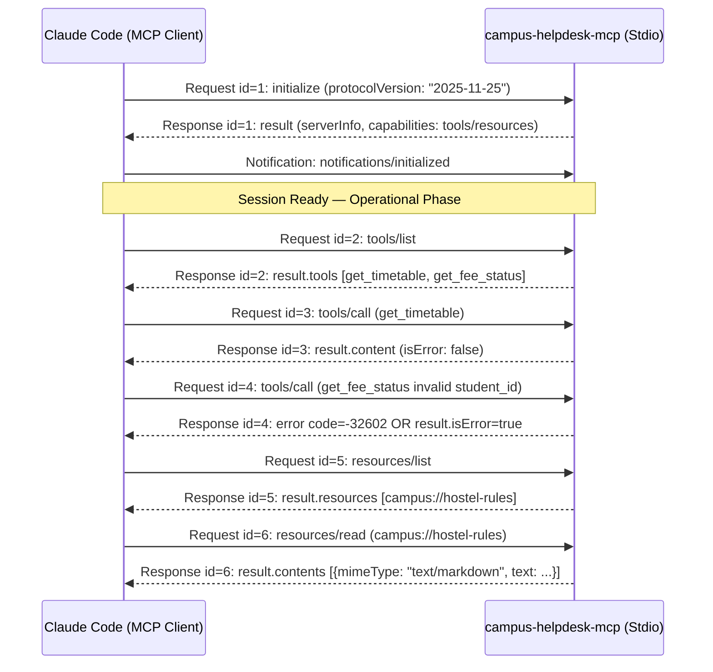

# Technical Architecture: Nimbus Labs Campus Helpdesk Agent

**Document Owner:** Principal Systems Architect  
**Repository Root:** `/Users/ns/code/ai-nimbus`  
**Verification Baseline Date:** `2026-11-17`  
**Target Platform:** macOS / POSIX (`zsh` / `bash`), Node.js `v26.7.0`, Python `3.15.2`, Git `2.55.0`, Claude Code `2.1.322`

---

## 1. Architectural Overview & Verified Toolchain Baseline

The **Nimbus Labs Campus Helpdesk Agent** is a deterministic, local-first AI agent package that unifies an open-standard **Agent Skill** (`timetable-helper`), a distributable **Claude Code Plugin** (`campus-helpdesk`), a **TypeScript stdio MCP Server** (`mcp-server/`), and a **Git Worktree Parallel Development Workflow** into a single self-contained repository.

### 1.1 Verified Tooling, Registry, and Specification Baseline (`2026-11-17`)

Every schema, CLI invocation, SDK import, and runtime invariant in this document has been verified directly against local toolchain binaries, the npm registry, and official specifications as of `2026-11-17`:

| Component / Tool | Verified Version / Status | Source / Verification Method | Architectural Consequence |
| :--- | :--- | :--- | :--- |
| **Claude Code CLI** | `2.1.322 (Claude Code)` | `claude --version` | Supports `claude plugin marketplace add`, `claude plugin install`, and `claude plugin validate --strict` |
| **Agent Skills Spec** | Open Standard + Claude Code Skills | `agentskills.io/specification` & `code.claude.com/docs/en/skills` | `SKILL.md` YAML frontmatter (`name`, `description`), `<500` line body, 3-tier progressive disclosure; **no `skill.config.yaml`** |
| **Claude Code Hooks** | `PreToolUse` JSON & Exit-Code Spec | `code.claude.com/docs/en/hooks` | Nested `hooks/hooks.json` wrapper; `exit 0` + `hookSpecificOutput.permissionDecision: "deny"` preferred over `exit 2` |
| **MCP TypeScript SDK** | `@modelcontextprotocol/sdk@1.32.2` | `npm view @modelcontextprotocol/sdk version` | ESM-first (`"type": "module"`), `McpServer`, `StdioServerTransport`, `registerTool`, `registerResource`, protocol `2025-11-25` |
| **Zod Schema Library** | `4.6.7` (SDK peer: `^3.25 \|\| ^4.0`) | `npm view zod version` & SDK `peerDependencies` | `server.registerTool()` requires full `z.object({...})` schemas (not raw shapes) |
| **`@nimbus/mcp-skill-bridge`** | **HTTP 404 (`E404` Non-Existent)** | `npm view @nimbus/mcp-skill-bridge` | **Strictly prohibited.** All MCP tools/resources are built directly on `@modelcontextprotocol/sdk` |
| **Node.js / npm** | Node `v26.7.0` / npm `11.19.0` | `node -v && npm -v` | Native ESM execution (`campus-helpdesk-mcp.mjs`) with zero runtime TypeScript transpilation needed by end users |
| **Python Runtime** | Python `3.15.2` | `python3 --version` | Skill script (`query_timetable.py`) and hook path canonicalizer use Python 3 stdlib exclusively (zero PyPI dependencies) |
| **Git Worktrees** | `git version 2.55.0` | `git --version` & `git worktree -h` | Standard `add`, `list`, `remove`, `prune`. **`git worktree sync` and `/worktree-merge` do NOT exist** |

### 1.2 System Topology

```mermaid
flowchart TD
    User["Student / Staff Prompt"] --> CC["Claude Code Runtime (v2.1.322)"]

    subgraph Marketplace["Marketplace Discovery (.claude-plugin/marketplace.json)"]
        M["nimbus-campus-marketplace"] -->|source: ./plugins/campus-helpdesk| Cache["Plugin Cache (~/.claude/plugins/cache/...)\nResolved as ${CLAUDE_PLUGIN_ROOT}"]
    end

    CC --> Cache

    subgraph Plugin["Plugin Boundary (${CLAUDE_PLUGIN_ROOT})"]
        Skill["Skill: campus-helpdesk:timetable-helper\n(SKILL.md + references/ + assets/ + scripts/)"]
        Cmd["Slash Command: /campus-helpdesk:timetable\n(commands/timetable.md)"]
        Hook["PreToolUse Guard: Write|Edit\n(hooks/hooks.json -> protect-data.sh)"]
        Protected["Read-Only Protected Data\n(data/protected/*)"]
        MCPCfg[".mcp.json\n(${CLAUDE_PLUGIN_ROOT}/servers/campus-helpdesk-mcp.mjs)"]
        Bundle["Bundled ESM Server\n(servers/campus-helpdesk-mcp.mjs)"]
        Data["Synced Runtime Data\n(data/hostel_rules.md)"]
    end

    Cmd --> Skill
    Skill -->|python3 stdlib| Py["scripts/query_timetable.py\n<- assets/timetable.csv"]
    CC -->|Tool Call: Write or Edit| Hook
    Hook -->|Target inside data/protected/| Deny["exit 0 + permissionDecision: deny"]
    Hook -->|Target outside data/protected/| Allow["exit 0 (Allow)"]
    CC <-->|JSON-RPC 2.0 over stdio\n(stdin / stdout; logs on stderr)| MCPCfg
    MCPCfg --> Bundle
    Bundle -->|reads| Data

    subgraph DevSource["Repo Authoring Workspace (mcp-server/)"]
        TS["src/index.ts + Zod + @modelcontextprotocol/sdk@1.32.2"] -->|npm run build (tsc)| Dist["dist/index.js"]
        TS -->|npm run build (esbuild)| Bundle
        SrcData["data/hostel_rules.md"] -->|npm run build (sync)| Data
    end
```

---

## 2. Canonical Repository Layout & Packaging Invariant

### 2.1 Directory Tree

```text
/Users/ns/code/ai-nimbus/
├── .claude-plugin/
│   └── marketplace.json                     # Root marketplace catalog for `claude plugin marketplace add ./`
├── README.md                                # Repository overview & developer quickstart
├── docs/
│   └── tech_architecture.md                 # This architectural specification
├── tests/                                   # Repo-level verification suites (excluded from plugin cache)
│   ├── skill/
│   │   └── test_query_timetable.py          # Python unittest suite for deterministic CSV parser
│   └── hooks/
│       └── test_protect_data.sh             # Adversarial PreToolUse JSON & traversal guard tests
├── mcp-server/                              # Authoritative TypeScript MCP server source & test workspace
│   ├── package.json                         # ESM package; @modelcontextprotocol/sdk@^1.32.2 + zod@^4.0.0
│   ├── tsconfig.json                        # Strict NodeNext TypeScript configuration
│   ├── README.md                            # Standalone MCP server usage, wire contract & test docs
│   ├── data/
│   │   └── hostel_rules.md                  # Canonical hostel rules markdown exposed via campus://hostel-rules
│   ├── scripts/
│   │   └── bundle-plugin.mjs                # esbuild bundler + asset sync into plugins/campus-helpdesk/
│   ├── src/
│   │   ├── index.ts                         # Stdio bootstrap entrypoint (Connects McpServer to StdioServerTransport)
│   │   ├── server.ts                        # McpServer factory registering tools, resources, and Zod schemas
│   │   ├── data.ts                          # Deterministic mock timetable + fee ledger + hostel rules loader
│   │   └── logger.ts                        # Strict stderr-only structured logger (stdout strictly forbidden)
│   ├── dist/                                # tsc build output for local dev & Node test execution
│   │   └── index.js
│   └── tests/
│       ├── tools-and-resources.test.ts      # Unit tests for tools, Zod errors, isError: true, and resource reads
│       └── stdio-protocol.test.ts           # Subprocess JSON-RPC 2.0 stdio handshake & stdout purity tests
└── plugins/
    └── campus-helpdesk/                     # Self-contained installable Claude Code plugin root
        ├── .claude-plugin/
        │   └── plugin.json                  # Plugin manifest (ONLY manifest lives inside .claude-plugin/)
        ├── .mcp.json                        # Plugin MCP declaration using ${CLAUDE_PLUGIN_ROOT}
        ├── README.md                        # >= 40 words + install line (satisfies `--profile directory`)
        ├── commands/
        │   └── timetable.md                 # /campus-helpdesk:timetable slash command
        ├── skills/
        │   └── timetable-helper/
        │       ├── SKILL.md                 # Tier 1 frontmatter + Tier 2 instructions (<500 lines)
        │       ├── references/
        │       │   ├── csv-dictionary.md    # Tier 3 canonical CSV schema & normalization spec
        │       │   └── edge-cases.md        # Tier 3 weekend, lab split, clash & fallback playbook
        │       ├── assets/
        │       │   └── timetable.csv        # Canonical UTF-8 LF timetable CSV dataset
        │       └── scripts/
        │           └── query_timetable.py   # Deterministic Python 3 stdlib CSV parser
        ├── hooks/
        │   ├── hooks.json                   # PreToolUse matcher ("Write|Edit") configuration
        │   └── scripts/
        │       └── protect-data.sh          # Executable guard blocking mutations under data/protected/
        ├── data/
        │   ├── hostel_rules.md              # Build-synced copy for self-contained plugin cache installs
        │   └── protected/                   # Immutable administrative mock files guarded by PreToolUse hook
        │       ├── fee_ledger_master.json
        │       ├── academic_calendar_2026.csv
        │       └── warden_escalation_roster.json
        └── servers/
            └── campus-helpdesk-mcp.mjs      # Self-contained esbuild ESM bundle (zero node_modules required)
```

### 2.2 Plugin Cache Isolation Invariant (Why Bundling Inside `plugins/campus-helpdesk/` Is Mandatory)

When a user executes:

```bash
claude plugin marketplace add ./
claude plugin install campus-helpdesk@nimbus-campus-marketplace
```

Claude Code copies **only** the target plugin directory (`plugins/campus-helpdesk/`) into a versioned cache directory under `~/.claude/plugins/cache/<marketplace>/<plugin>/<version>/` and binds `${CLAUDE_PLUGIN_ROOT}` to that cached path at runtime.

Consequently:
1. **No Parent Traversal (`..`) Across Plugin Root:** Paths such as `${CLAUDE_PLUGIN_ROOT}/../../mcp-server/dist/index.js` **fail** after marketplace installation because `mcp-server/` is outside `plugins/campus-helpdesk/` and is never copied to the cache.
2. **Zero Runtime `node_modules` Requirement in Cache:** Marketplace cache installs do not run `npm install`. Therefore, `mcp-server/scripts/bundle-plugin.mjs` uses `esbuild` (`--bundle --platform=node --format=esm`) to emit a single zero-dependency executable ESM artifact at `plugins/campus-helpdesk/servers/campus-helpdesk-mcp.mjs`, and mirrors `mcp-server/data/hostel_rules.md` to `plugins/campus-helpdesk/data/hostel_rules.md`.
3. **Manifest Placement Rule:** `.claude-plugin/plugin.json` lives inside `.claude-plugin/`. All functional directories (`skills/`, `commands/`, `hooks/`, `data/`, `servers/`) and `.mcp.json` MUST reside at `plugins/campus-helpdesk/` root—never inside `.claude-plugin/`.

---

## 3. Subsystem 1: Agent Skill (`timetable-helper`)

### 3.1 Specification Compliance

`plugins/campus-helpdesk/skills/timetable-helper/` conforms strictly to the [Agent Skills open standard](https://agentskills.io/specification) and [Claude Code Skills documentation](https://code.claude.com/docs/en/skills):

* **No `skill.config.yaml`:** Non-standard configuration files such as `skill.config.yaml` MUST NOT exist anywhere in the skill directory.
* **Self-Contained Portability:** All instructions, schemas, static assets, and deterministic scripts reside inside `skills/timetable-helper/`.

### 3.2 Three-Tier Progressive Disclosure Architecture

To preserve context-window budget while enforcing deterministic execution, `timetable-helper` separates knowledge across three load stages:

#### Tier 1: Discovery Metadata (Always Loaded)

Only the YAML frontmatter of `SKILL.md` is loaded into the agent's initial skill index (minimal token footprint). **Only `name` and `description` are used** in the `SKILL.md` frontmatter:

```yaml
---
name: timetable-helper
description: Look up verified campus class schedules, room numbers, course codes, and instructors by student batch, weekday, course, or room from the canonical timetable dataset. Use when students or staff ask about class timings, daily schedules, lecture rooms, lab slots, or weekly timetables.
---
```

**Frontmatter Constraints:**
* `name`: `timetable-helper` — `16` characters (`<= 64` max), matches `^[a-z0-9-]+$`, does not start/end with `-`, contains no reserved words (`claude`, `anthropic`), and matches parent folder name `timetable-helper`.
* `description`: `275` characters (`<= 1024` max), non-empty, encodes both functional scope and explicit trigger intents so Claude avoids undertriggering.

#### Tier 2: Activation Playbook (`SKILL.md` Body, `< 500` Lines)

Loaded on demand only when Claude activates `timetable-helper` (or via `/campus-helpdesk:timetable`). Target length: `~110–160` lines (strictly `< 500` lines).

**Required `SKILL.md` Playbook Rules:**
1. **Execution Routing:**
   * Always run `python3 "${CLAUDE_PLUGIN_ROOT}/skills/timetable-helper/scripts/query_timetable.py"` (or fallback relative path `./scripts/query_timetable.py` if invoked standalone) with `--format json` when inspecting schedules from shell.
   * When the `campus-helpdesk` MCP server is active and the user queries `(batch, day)` directly, `mcp__plugin_campus-helpdesk_campus-helpdesk__get_timetable` provides equivalent deterministic lookup; for multi-filter queries (`--course`, `--room`, `--list-batches`), invoke `scripts/query_timetable.py`.
2. **Tier 3 On-Demand Pointers:**
   * Consult `references/csv-dictionary.md` only when interpreting column semantics, term codes, or lab-group codes.
   * Consult `references/edge-cases.md` only when encountering weekend queries, elective conflicts, cancelled slots, unknown batches, or cross-listed sections.
3. **Output Formatting Contract:** Present returned records as a clean markdown table sorted chronologically by `start_time`, including timezone (`IST`), room, course code, session type, and instructor.

#### Tier 3: Execution Assets, References & Deterministic Script

1. **`references/csv-dictionary.md`**:
   * Defines exact columns of `assets/timetable.csv`, allowed values, `HH:MM` 24-hour IST (`Asia/Kolkata`) semantics, `session_type` values (`LECTURE`, `LAB`, `TUTORIAL`), and batch naming conventions (`CSE-A`, `CSE-B`, `ECE-A`, `AI-DS-A`).
2. **`references/edge-cases.md`**:
   * Documents deterministic handling for:
     * Weekend queries (`Saturday`, `Sunday`): valid days with `0` regular classes (must state no regular classes scheduled, never invent makeup classes).
     * Day aliases & case normalization (`mon` / `MON` / `Monday` -> `Monday`; `cse-a` / `CSE A` -> `CSE-A`).
     * Unknown batch codes (e.g., `MECH-Z`): return empty match + list of `valid_batches` from CSV; never extrapolate from `CSE-A`.
     * Lab sub-batch splits (`L1`/`L2` noted in `session_type` or `notes` field) and cross-listed electives.
3. **`assets/timetable.csv`**:
   * Encoding: UTF-8 (no BOM), Unix LF (`\n`) line endings, RFC 4180 compliant quoting.
   * Canonical header schema (11 columns):
     ```csv
     batch,day,start_time,end_time,course_code,course_title,session_type,room,instructor,credits,term
     ```
   * Populated with deterministic records spanning `CSE-A`, `CSE-B`, `ECE-A`, and `AI-DS-A` across `Monday`–`Friday` (aligned 1:1 with the MCP server's timetable dataset so skill script and MCP tool never diverge).
4. **`scripts/query_timetable.py`**:
   * **Runtime Constraint:** Pure Python 3 standard library only (`argparse`, `csv`, `json`, `pathlib`, `re`, `sys`). Zero `pip` dependencies.
   * **CLI Interface:**
     ```text
     python3 query_timetable.py [--batch BATCH] [--day DAY] [--course CODE] [--room ROOM]
                                [--csv PATH] [--format {json,markdown}] [--list-batches]
     ```
   * **Normalization & Determinism:**
     * Canonicalizes `day` via lookup map (`mon` -> `Monday`, ..., `sun` -> `Sunday`). Invalid day tokens fail with exit code `2` and structured JSON error on `stderr`.
     * Canonicalizes `batch` by uppercasing and normalizing whitespace/underscores to hyphens (`cse a` / `cse_a` -> `CSE-A`).
     * Resolves default CSV relative to `Path(__file__).resolve().parent.parent / "assets" / "timetable.csv"` so invocation works regardless of `cwd`.
     * Sorts matched rows deterministically by `(DAY_ORDER[row["day"]], row["start_time"], row["course_code"])`.
   * **Exit Codes:**
     * `0`: Valid query executed (including `0` matching rows, returning `{"matched": 0, "query": {...}, "rows": [], "valid_batches": [...]}`).
     * `2`: Invalid CLI flag, unrecognized `--day` token, missing CSV file, or malformed CSV header.

### 3.3 Anti-Fabrication Grounding Invariant

> **INVARIANT (Zero-Fabrication Schedule Grounding):**  
> The agent **MUST NEVER** recall, guess, interpolate, or synthesize any timetable slot, room number, instructor name, or course timing from parametric memory or partial matches. Every timetable assertion returned to the user **MUST** trace directly to a verified JSON/CSV row emitted by `scripts/query_timetable.py` or `get_timetable`. If `matched == 0` (or the MCP server returns zero rows / `isError: true`), the agent **MUST** explicitly report that no matching schedule exists and surface only the `valid_batches` / `valid_days` enumerated by the deterministic backend.

---

## 4. Subsystem 2: Claude Code Plugin (`campus-helpdesk`)

### 4.1 Root Marketplace Manifest (`.claude-plugin/marketplace.json`)

Placed at `/Users/ns/code/ai-nimbus/.claude-plugin/marketplace.json`. Verified against `claude plugin validate --strict` (Claude Code `2.1.322`):

```json
{
  "$schema": "https://json.schemastore.org/claude-code-marketplace.json",
  "name": "nimbus-campus-marketplace",
  "owner": {
    "name": "Nimbus Labs",
    "email": "engineering@nimbuslabs.edu"
  },
  "metadata": {
    "description": "Nimbus Labs Campus Helpdesk plugin catalog",
    "version": "1.0.0"
  },
  "plugins": [
    {
      "name": "campus-helpdesk",
      "source": "./plugins/campus-helpdesk",
      "description": "Campus Helpdesk Agent bundling timetable skill, protected-data guard hooks, and campus MCP server",
      "version": "1.0.0",
      "author": {
        "name": "Nimbus Labs"
      },
      "category": "productivity"
    }
  ]
}
```

**Schema Precision Notes:**
* Catalog-level `version` and `description` reside inside `metadata` (`metadata.version`, `metadata.description`), as `metadata` strictly accepts `description`, `version`, and `pluginRoot`.
* `plugins[].name` (`"campus-helpdesk"`) MUST match `plugins/campus-helpdesk/.claude-plugin/plugin.json` `name` (`"campus-helpdesk"`).
* `plugins[].source` uses relative path `"./plugins/campus-helpdesk"` so local installation works directly from the git repo root:
  ```bash
  claude plugin marketplace add ./
  claude plugin install campus-helpdesk@nimbus-campus-marketplace
  ```

### 4.2 Plugin Manifest (`plugins/campus-helpdesk/.claude-plugin/plugin.json`)

Verified against `claude plugin validate --strict`:

```json
{
  "name": "campus-helpdesk",
  "version": "1.0.0",
  "description": "Campus Helpdesk Agent plugin with deterministic timetable skill, data-protection hooks, and stdio MCP server",
  "author": {
    "name": "Nimbus Labs",
    "email": "engineering@nimbuslabs.edu"
  },
  "license": "MIT",
  "keywords": [
    "campus",
    "timetable",
    "mcp",
    "helpdesk"
  ]
}
```

**Automatic Component Discovery & Namespacing:**
* Because `skills/`, `commands/`, `hooks/hooks.json`, and `.mcp.json` sit at their canonical plugin root paths, Claude Code discovers them automatically without redundant overrides in `plugin.json`.
* **Runtime Namespaces:**
  * Skill: `campus-helpdesk:timetable-helper`
  * Slash Command: `/campus-helpdesk:timetable`
  * MCP Server (in `/mcp`): `plugin:campus-helpdesk:campus-helpdesk`
  * MCP Tools exposed to model:
    * `mcp__plugin_campus-helpdesk_campus-helpdesk__get_timetable`
    * `mcp__plugin_campus-helpdesk_campus-helpdesk__get_fee_status`
* **Directory Profile Readiness (`--profile directory`):** `plugins/campus-helpdesk/README.md` MUST contain at least `40` words and include an explicit marketplace install command line (`/plugin install campus-helpdesk --marketplace <owner>/<repo>`).

### 4.3 Slash Command (`plugins/campus-helpdesk/commands/timetable.md`)

Invoked explicitly by users via `/campus-helpdesk:timetable <batch> [day]`:

```markdown
---
description: Look up the deterministic campus class timetable for a batch and optional day
argument-hint: "<batch> [day]"
---

Resolve the campus timetable query for `$ARGUMENTS`.

Rules:
1. Parse `<batch>` and optional `[day]` from `$ARGUMENTS`. If `$ARGUMENTS` is empty, ask the user for a valid batch (or run `query_timetable.py --list-batches` to present available batches).
2. Execute `python3 "${CLAUDE_PLUGIN_ROOT}/skills/timetable-helper/scripts/query_timetable.py" --batch "<batch>" [--day "<day>"] --format json` (or call `get_timetable` if both batch and day are provided and the MCP server is connected).
3. Follow all Anti-Fabrication Grounding Invariants from `skills/timetable-helper/SKILL.md`: report only verified rows from tool/script output, sorted chronologically with IST times, rooms, and instructors.
```

### 4.4 Protected-Data Guard Hook (`hooks/hooks.json` & `hooks/scripts/protect-data.sh`)

#### 4.4.1 `hooks/hooks.json` Schema

Uses the nested wrapper format required by Claude Code (`hooks` -> `PreToolUse` -> matcher array -> `hooks` handler array):

```json
{
  "hooks": {
    "PreToolUse": [
      {
        "matcher": "Write|Edit",
        "hooks": [
          {
            "type": "command",
            "command": "\"${CLAUDE_PLUGIN_ROOT}/hooks/scripts/protect-data.sh\""
          }
        ]
      }
    ]
  }
}
```

* `${CLAUDE_PLUGIN_ROOT}` is quoted to remain safe if the user's home or cache path contains spaces.
* `matcher` is `"Write|Edit"` (regex alternation matching `Write` and `Edit` tool names).
* *(Defense-in-Depth Note: In addition to the `PreToolUse` hook on `Write|Edit`, files under `data/protected/` carry `0444` read-only permissions on disk as a secondary OS-level safeguard.)*

#### 4.4.2 `PreToolUse` Stdin Contract

When `Write` or `Edit` is invoked, Claude Code pipes a JSON object to `protect-data.sh` on `stdin`:

```json
{
  "session_id": "sess_01abc...",
  "transcript_path": "/Users/ns/.claude/projects/.../transcript.jsonl",
  "cwd": "/Users/ns/code/ai-nimbus",
  "permission_mode": "default",
  "hook_event_name": "PreToolUse",
  "tool_name": "Write",
  "tool_input": {
    "file_path": "plugins/campus-helpdesk/data/protected/fee_ledger_master.json",
    "content": "{}"
  }
}
```

#### 4.4.3 Path Canonicalization & Traversal-Safe Parsing (`protect-data.sh`)

Naive substring matching (e.g., `[[ "$FILE_PATH" == *"data/protected"* ]]`) is vulnerable to:
* Path traversal (`data/public/../protected/fee_ledger_master.json`),
* Backslash/duplicate-slash obfuscation (`data//protected/fee_ledger_master.json`),
* Relative paths evaluated from a sub-directory `cwd`, or
* Symlink redirection pointing inside `data/protected/`.

Therefore, `protect-data.sh` (`chmod +x`, `set -euo pipefail`) delegates JSON extraction and path canonicalization to `python3` (avoiding dependency on non-standard `jq`):

1. Read full `stdin` JSON payload.
2. **Fail-Closed Parse Guard:** If `stdin` is invalid JSON or `tool_input.file_path` is missing/non-string on a matched `Write|Edit` call, immediately emit the `permissionDecision: "deny"` JSON response and exit `0`.
3. Extract `file_path` (`tool_input.file_path`) and `cwd` (defaulting to `os.getcwd()`).
4. Resolve `candidate = os.path.realpath(os.path.join(cwd, file_path))` (note: `os.path.join` naturally handles absolute `file_path`, and `os.path.realpath` collapses `.`, `..`, duplicate `/`, and resolves symlinks). Also compute `lexical = os.path.normpath(os.path.join(cwd, file_path))` to catch paths whose parent does not yet exist on disk.
5. Check whether:
   * Either `candidate` or `lexical` contains the exact normalized path-segment sequence `("data", "protected")` (checked via `Path(p).parts` sliding 2-tuple check, preventing false positives on unrelated names like `data_protected_backup`), **OR**
   * `candidate` / `lexical` resides within `${CLAUDE_PLUGIN_ROOT}/data/protected` (resolved via `realpath`).
6. If matched -> emit deny JSON on `stdout` and `exit 0`. If safe -> emit nothing and `exit 0`.

#### 4.4.4 Claude Code `PreToolUse` Decision Contract (`exit 0` JSON vs `exit 2` stderr)

Claude Code supports two blocking mechanisms for `PreToolUse` hooks:

| Mechanism | Exit Code | Output Channel | Behavior in Claude Code | Architectural Choice |
| :--- | :--- | :--- | :--- | :--- |
| **Structured JSON (`hookSpecificOutput`)** | **`0`** | `stdout` (JSON) | Blocks tool call cleanly (`permissionDecision: "deny"`), feeds `permissionDecisionReason` back to Claude as structured feedback without aborting turn | **PRIMARY (Required)** |
| **Hard-Stop Exit Code** | `2` | `stderr` (plain text) | Blocks tool call and passes `stderr` to Claude, but acts as a legacy hard stop that may halt multi-step recovery | Documented fallback only |
| **Other Non-Zero (`1`, `127`, etc.)** | `1`, `127`, etc. | `stderr` | Treated as hook script error; typically **fails open** (allows tool call with warning) | **Never use for policy denials** |

**Exact JSON Output Emitted by `protect-data.sh` on Denial (with `exit 0`):**

```json
{
  "hookSpecificOutput": {
    "hookEventName": "PreToolUse",
    "permissionDecision": "deny",
    "permissionDecisionReason": "Blocked by campus-helpdesk security policy: modifications to protected administrative data under 'data/protected/' are prohibited."
  }
}
```

#### 4.4.5 Protected Mock Dataset (`plugins/campus-helpdesk/data/protected/`)

| File | Format | Purpose |
| :--- | :--- | :--- |
| `fee_ledger_master.json` | JSON | Master student fee ledger snapshot (immutable source record) |
| `academic_calendar_2026.csv` | CSV | Official term start/end and holiday calendar |
| `warden_escalation_roster.json` | JSON | Restricted hostel warden emergency contact directory |

### 4.5 Plugin MCP Configuration (`plugins/campus-helpdesk/.mcp.json`)

```json
{
  "mcpServers": {
    "campus-helpdesk": {
      "type": "stdio",
      "command": "node",
      "args": [
        "${CLAUDE_PLUGIN_ROOT}/servers/campus-helpdesk-mcp.mjs"
      ],
      "env": {
        "CAMPUS_DATA_DIR": "${CLAUDE_PLUGIN_ROOT}/data"
      }
    }
  }
}
```

* Top-level key MUST be `"mcpServers"`.
* Uses `"${CLAUDE_PLUGIN_ROOT}"` in both `args` and `env` so cached marketplace installs resolve cleanly without `..` traversal.

---

## 5. Subsystem 3: TypeScript MCP Server (`mcp-server/`)

### 5.1 Package Manifest & TypeScript Configuration

#### `mcp-server/package.json`

```json
{
  "name": "campus-helpdesk-mcp",
  "version": "1.0.0",
  "private": true,
  "type": "module",
  "description": "Nimbus Labs Campus Helpdesk MCP Server over stdio",
  "main": "dist/index.js",
  "scripts": {
    "typecheck": "tsc --noEmit",
    "build:tsc": "tsc",
    "build:bundle": "node scripts/bundle-plugin.mjs",
    "build": "npm run typecheck && npm run build:tsc && npm run build:bundle",
    "test": "node --import tsx --test tests/*.test.ts",
    "start": "node dist/index.js"
  },
  "dependencies": {
    "@modelcontextprotocol/sdk": "^1.32.2",
    "zod": "^4.0.0"
  },
  "devDependencies": {
    "@types/node": "^22.0.0",
    "esbuild": "^0.25.0",
    "tsx": "^4.19.0",
    "typescript": "^5.8.0"
  }
}
```

#### `mcp-server/tsconfig.json`

```json
{
  "compilerOptions": {
    "target": "ES2022",
    "module": "NodeNext",
    "moduleResolution": "NodeNext",
    "outDir": "dist",
    "rootDir": "src",
    "strict": true,
    "esModuleInterop": true,
    "skipLibCheck": true,
    "forceConsistentCasingInFileNames": true,
    "declaration": true,
    "sourceMap": true
  },
  "include": ["src/**/*.ts"]
}
```

#### Dual-Output Build Pipeline (`scripts/bundle-plugin.mjs`)

Running `npm run build` inside `mcp-server/` executes:
1. `tsc --noEmit` & `tsc` -> emits compiled Node ESM files to `mcp-server/dist/index.js`.
2. `esbuild` -> bundles `src/index.ts` into `../plugins/campus-helpdesk/servers/campus-helpdesk-mcp.mjs`:
   * Flags: `bundle: true`, `platform: "node"`, `format: "esm"`, `target: "node20"`, `sourcemap: false`.
   * **CJS Interop Banner:** Injects `import { createRequire as __createRequire } from 'node:module'; const require = __createRequire(import.meta.url);` so any transitive Node built-in `require()` call inside bundled dependencies cannot throw `Dynamic require is not supported` in ESM `.mjs` mode.
3. **Data Synchronization:** Copies `mcp-server/data/hostel_rules.md` -> `../plugins/campus-helpdesk/data/hostel_rules.md` so the cached plugin remains self-contained and identical to the source repository.

### 5.2 SDK Integration & Zod v4 Contract (`src/server.ts`)

1. **Direct SDK Imports (No Bridge Package):**
   ```typescript
   import { McpServer } from "@modelcontextprotocol/sdk/server/mcp.js";
   import { StdioServerTransport } from "@modelcontextprotocol/sdk/server/stdio.js";
   import { ErrorCode, McpError } from "@modelcontextprotocol/sdk/types.js";
   import { z } from "zod";
   ```
2. **Zod v4 `registerTool()` Invariant:** In `@modelcontextprotocol/sdk@1.32.2`, `server.registerTool(name, config, handler)` strictly expects `config.inputSchema` to be a **`ZodObject`** (`z.object({...})`), **NOT** a raw property map `{ batch: z.string() }`. Passing a raw shape triggers TypeScript `AnySchema` assignability failures and runtime `-32602` validation errors.

### 5.3 Tool & Resource Contracts

#### 5.3.1 Tool 1: `get_timetable`

* **Registration Name:** `"get_timetable"`
* **Zod Input Schema (`ZodObject`):**
  ```typescript
  const GetTimetableInputSchema = z.object({
    batch: z
      .string()
      .trim()
      .min(1, "batch is required (e.g., CSE-A, CSE-B, ECE-A, AI-DS-A)")
      .describe("Student batch identifier, e.g. CSE-A, CSE-B, ECE-A, AI-DS-A"),
    day: z
      .string()
      .trim()
      .min(1, "day is required (Monday through Sunday or abbreviation)")
      .describe("Day of the week, e.g. Monday, Tue, Friday")
  });
  ```
* **Deterministic Normalization & Lookup:**
  * Normalizes `batch`: uppercase, whitespace/underscore collapsed to `-` (`"cse a"` -> `"CSE-A"`).
  * Normalizes `day`: maps full names and 3-letter prefixes (`"mon"` -> `"Monday"`, ..., `"sun"` -> `"Sunday"`).
  * Canonical valid batches: `["CSE-A", "CSE-B", "ECE-A", "AI-DS-A"]`.
* **Response & Error Semantics:**
  * **Schema / Type Violation** (e.g., missing `batch` or non-string `day`): Rejected by MCP SDK before handler runs -> **JSON-RPC Error `-32602` (`InvalidParams`)**.
  * **Domain Validation Failure** (unknown `batch` like `"MECH-Z"` or invalid `day` token like `"Funday"`): Handler returns structured tool error with **`isError: true`** so Claude can self-correct or inform the user accurately:
    ```json
    {
      "error": "UNKNOWN_BATCH",
      "message": "Batch 'MECH-Z' was not found in the campus timetable.",
      "valid_batches": ["AI-DS-A", "CSE-A", "CSE-B", "ECE-A"]
    }
    ```
  * **Valid Teaching-Off Weekend (`Saturday` / `Sunday` for valid batch):** Returns **`isError: false`** with:
    ```json
    {
      "batch": "CSE-A",
      "day": "Saturday",
      "timezone": "Asia/Kolkata (IST)",
      "classes": [],
      "note": "No regular classes scheduled on Saturday."
    }
    ```
  * **Valid Teaching Day Match:** Returns **`isError: false`** with JSON text payload containing `batch`, `day`, `timezone: "Asia/Kolkata (IST)"`, `count`, and chronologically sorted `classes[]` (`start_time`, `end_time`, `course_code`, `course_title`, `session_type`, `room`, `instructor`, `credits`, `term`).

#### 5.3.2 Tool 2: `get_fee_status`

* **Registration Name:** `"get_fee_status"`
* **Zod Input Schema (`ZodObject`):**
  ```typescript
  const GetFeeStatusInputSchema = z.object({
    student_id: z
      .string()
      .trim()
      .regex(/^STU-\d{4}-\d{3}$/i, "student_id must match format STU-YYYY-NNN (e.g., STU-2026-001)")
      .describe("Canonical student ID formatted as STU-YYYY-NNN, e.g. STU-2026-001")
  });
  ```
* **Deterministic Mock Ledger (`src/data.ts`):**

| `student_id` | Student Name | Batch | Term | Status | Total INR | Paid INR | Balance INR | Due Date |
| :--- | :--- | :--- | :--- | :--- | ---: | ---: | ---: | :--- |
| `STU-2026-001` | Aarav Sharma | `CSE-A` | `Fall-2026` | `PAID` | `125000` | `125000` | `0` | `2026-08-15` |
| `STU-2026-002` | Diya Nair | `CSE-B` | `Fall-2026` | `PARTIAL` | `125000` | `75000` | `50000` | `2026-11-30` |
| `STU-2026-003` | Rohan Kulkarni | `ECE-A` | `Fall-2026` | `OVERDUE` | `118000` | `60000` | `58000` | `2026-10-15` |
| `STU-2026-004` | Meera Krishnan | `AI-DS-A` | `Fall-2026` | `WAIVED` | `130000` | `130000` | `0` | `2026-08-15` |
| `STU-2026-005` | Kabir Verma | `CSE-A` | `Fall-2026` | `PENDING_VERIFICATION` | `125000` | `125000` | `0` | `2026-11-20` |

*(Input `student_id` is uppercased before lookup so `"stu-2026-001"` matches `"STU-2026-001"` deterministically.)*

* **Response & Error Semantics:**
  * **Schema / Format Violation** (missing `student_id`, non-string, or failing `^STU-\d{4}-\d{3}$` regex such as `"12345"`): Rejected by SDK Zod validator -> **JSON-RPC Error `-32602` (`InvalidParams`)**.
  * **Record Not Found** (syntactically valid ID absent from mock ledger, e.g. `"STU-2026-999"`): Handler returns **`isError: true`** with `{ "error": "STUDENT_NOT_FOUND", "student_id": "STU-2026-999", "message": "No fee record exists for STU-2026-999." }`.
  * **Success:** Returns **`isError: false`** with full breakdown (`tuition_inr`, `hostel_inr`, `late_fee_inr`, `last_payment_ref`, `status`, `balance_inr`, `due_date`).

#### 5.3.3 Resource: `campus://hostel-rules`

* **Registration:**
  ```typescript
  server.registerResource(
    "hostel-rules",
    "campus://hostel-rules",
    {
      title: "Nimbus Campus Hostel Rules & Curfew Policy",
      description: "Official campus hostel curfew timings, visitor policies, mess hours, and disciplinary guidelines",
      mimeType: "text/markdown"
    },
    async (uri) => {
      const markdown = await loadHostelRulesMarkdown();
      return {
        contents: [
          {
            uri: uri.href,
            mimeType: "text/markdown",
            text: markdown
          }
        ]
      };
    }
  );
  ```
* **Deterministic File Resolution (`loadHostelRulesMarkdown()`):**
  1. If `process.env.CAMPUS_DATA_DIR` is set -> read `path.resolve(process.env.CAMPUS_DATA_DIR, "hostel_rules.md")`.
  2. Otherwise -> read `path.resolve(path.dirname(fileURLToPath(import.meta.url)), "../data/hostel_rules.md")`.
     *Notice why `../data/hostel_rules.md` is symmetrical across both execution targets:*
     * From `mcp-server/dist/index.js` -> resolves to `mcp-server/data/hostel_rules.md`.
     * From `plugins/campus-helpdesk/servers/campus-helpdesk-mcp.mjs` -> resolves to `plugins/campus-helpdesk/data/hostel_rules.md`.
* **Resource Error Contract:** Because MCP resources are application-driven and do not support `isError`, any missing/unreadable `hostel_rules.md` MUST throw `new McpError(ErrorCode.InternalError, "Unable to read hostel_rules.md")` (JSON-RPC `-32603`), and requests for unregistered URIs return a JSON-RPC protocol error.

### 5.4 Stdio Transport & Stdout Silence Invariant

> **INVARIANT (Strict Stdio Stream Separation):**  
> When connected to `StdioServerTransport`, `process.stdout` is **exclusively reserved** for newline-delimited JSON-RPC 2.0 protocol messages.
> 1. `console.log()`, `console.info()`, `console.debug()`, and `process.stdout.write()` are **strictly banned** across all files under `mcp-server/src/`.
> 2. All startup logs, request diagnostics, and fatal errors MUST write solely to `process.stderr` via `console.error()` (wrapped in `src/logger.ts`).
> 3. A single stray byte on `stdout` before or between JSON-RPC frames corrupts client parsing and constitutes a build-blocking test failure.

### 5.5 JSON-RPC 2.0 Lifecycle & Wire Contract



#### Verbatim Wire Payloads

**1. `initialize` (Request -> Response)**

```json
// Client -> Server (stdin)
{"jsonrpc":"2.0","id":1,"method":"initialize","params":{"protocolVersion":"2025-11-25","capabilities":{},"clientInfo":{"name":"claude-code","version":"2.1.322"}}}

// Server -> Client (stdout)
{"jsonrpc":"2.0","id":1,"result":{"protocolVersion":"2025-11-25","capabilities":{"tools":{"listChanged":false},"resources":{"subscribe":false,"listChanged":false}},"serverInfo":{"name":"campus-helpdesk","version":"1.0.0"}}}
```

**2. `notifications/initialized` (Client Notification — No `id`, No Response)**

```json
{"jsonrpc":"2.0","method":"notifications/initialized"}
```

**3. `tools/list` (Request -> Response)**

```json
// Client -> Server (stdin)
{"jsonrpc":"2.0","id":2,"method":"tools/list","params":{}}

// Server -> Client (stdout)
{"jsonrpc":"2.0","id":2,"result":{"tools":[{"name":"get_timetable","description":"...","inputSchema":{"type":"object","properties":{"batch":{"type":"string","minLength":1,"description":"..."},"day":{"type":"string","minLength":1,"description":"..."}},"required":["batch","day"],"additionalProperties":false}},{"name":"get_fee_status","description":"...","inputSchema":{"type":"object","properties":{"student_id":{"type":"string","pattern":"^STU-\\d{4}-\\d{3}$","description":"..."}},"required":["student_id"],"additionalProperties":false}}]}}
```

**4. `tools/call` — Success, Domain Error (`isError: true`), and Schema Error (`-32602`)**

```json
// (a) Valid Call: get_timetable
{"jsonrpc":"2.0","id":3,"method":"tools/call","params":{"name":"get_timetable","arguments":{"batch":"CSE-A","day":"Monday"}}}
// Response:
{"jsonrpc":"2.0","id":3,"result":{"content":[{"type":"text","text":"{\"batch\":\"CSE-A\",\"day\":\"Monday\",\"timezone\":\"Asia/Kolkata (IST)\",\"count\":3,\"classes\":[...]}"}],"isError":false}}

// (b) Domain Error (Unknown Record): get_fee_status with valid regex but unknown ID
{"jsonrpc":"2.0","id":4,"method":"tools/call","params":{"name":"get_fee_status","arguments":{"student_id":"STU-2026-999"}}}
// Response (Tool execution error; LLM can recover):
{"jsonrpc":"2.0","id":4,"result":{"content":[{"type":"text","text":"{\"error\":\"STUDENT_NOT_FOUND\",\"student_id\":\"STU-2026-999\",\"message\":\"No fee record exists for STU-2026-999.\"}"}],"isError":true}}

// (c) Schema Violation (Regex / Type Failure): get_fee_status with malformed ID
{"jsonrpc":"2.0","id":5,"method":"tools/call","params":{"name":"get_fee_status","arguments":{"student_id":"bad-id"}}}
// Response (Protocol-level JSON-RPC InvalidParams):
{"jsonrpc":"2.0","id":5,"error":{"code":-32602,"message":"MCP error -32602: Invalid arguments for tool get_fee_status: ..."}}
```

**5. `resources/list` & `resources/read` (`campus://hostel-rules`)**

```json
// Client -> Server: resources/list
{"jsonrpc":"2.0","id":6,"method":"resources/list","params":{}}
// Server -> Client:
{"jsonrpc":"2.0","id":6,"result":{"resources":[{"uri":"campus://hostel-rules","name":"hostel-rules","title":"Nimbus Campus Hostel Rules & Curfew Policy","description":"...","mimeType":"text/markdown"}]}}

// Client -> Server: resources/read
{"jsonrpc":"2.0","id":7,"method":"resources/read","params":{"uri":"campus://hostel-rules"}}
// Server -> Client:
{"jsonrpc":"2.0","id":7,"result":{"contents":[{"uri":"campus://hostel-rules","mimeType":"text/markdown","text":"# Nimbus Campus Hostel Rules & Curfew Policy\n..."}]}}
```

---

## 6. Subsystem 4: Git Worktrees Parallel Development Plan

### 6.1 Explicit CLI Non-Existence Warning

> **VERIFIED FACT (`git 2.55.0` & `Claude Code 2.1.322`):**  
> Neither **`git worktree sync`** nor **`/worktree-merge`** exists in Git or Claude Code. Any automation script, skill prompt, or engineering SOP referencing those commands will fail immediately. All branch synchronization and cleanup MUST use standard Git primitives (`git worktree add`, `git merge --no-ff`, `git worktree remove`, `git worktree prune`).

### 6.2 Worktree Topology & Ownership Matrix

Starting from a clean baseline commit on `main` at `/Users/ns/code/ai-nimbus`, three linked worktrees are provisioned in **sibling directories** (never nested inside `/Users/ns/code/ai-nimbus` so untracked directory pollution cannot occur):

| Worktree Directory | Branch Name | Primary Owned Files | Purpose |
| :--- | :--- | :--- | :--- |
| `/Users/ns/code/ai-nimbus` | `main` | Integration trunk, `.claude-plugin/marketplace.json`, `docs/` | Baseline & release integration only |
| `/Users/ns/code/ai-nimbus-wt-skill-tests` | `feature/skill-tests` | `plugins/campus-helpdesk/skills/timetable-helper/**`, `commands/timetable.md`, `tests/skill/**` | Skill CSV dictionary, edge cases, Python stdlib parser & unit tests |
| `/Users/ns/code/ai-nimbus-wt-mcp-server` | `feature/mcp-server` | `mcp-server/**`, `plugins/campus-helpdesk/servers/**`, `plugins/campus-helpdesk/.mcp.json`, `plugins/campus-helpdesk/data/hostel_rules.md` | TypeScript MCP server, Zod validation, `esbuild` plugin bundle, stdio tests |
| `/Users/ns/code/ai-nimbus-wt-hook-path` | `bugfix/hook-path` | `plugins/campus-helpdesk/hooks/**`, `plugins/campus-helpdesk/data/protected/**`, `tests/hooks/**` | `PreToolUse` `protect-data.sh` canonical path traversal hardening & tests |

**Provisioning Commands (from `main` baseline):**

```bash
git worktree add -b feature/skill-tests ../ai-nimbus-wt-skill-tests main
git worktree add -b feature/mcp-server  ../ai-nimbus-wt-mcp-server  main
git worktree add -b bugfix/hook-path    ../ai-nimbus-wt-hook-path    main
git worktree list
```

### 6.3 Git Internals: `$GIT_COMMON_DIR` vs Per-Worktree State

Understanding what is shared versus isolated prevents cross-worktree corruption during parallel execution:

```text
/Users/ns/code/ai-nimbus/.git/          <-- $GIT_COMMON_DIR (Shared across ALL worktrees)
├── objects/                            <-- Shared commit/tree/blob object database
├── refs/heads/*                        <-- Shared branch tips (all branches visible everywhere)
├── packed-refs & config                <-- Shared repo config & packed refs
└── worktrees/
    ├── ai-nimbus-wt-mcp-server/        <-- Per-worktree $GIT_DIR
    │   ├── HEAD                        <-- Isolated HEAD (ref: refs/heads/feature/mcp-server)
    │   ├── index                       <-- Isolated staging area
    │   ├── gitdir                      <-- Points back to ../ai-nimbus-wt-mcp-server/.git
    │   ├── commondir                   <-- Contains "../.." pointing to $GIT_COMMON_DIR
    │   └── ORIG_HEAD / MERGE_HEAD      <-- Isolated merge/rebase state
    └── ...

/Users/ns/code/ai-nimbus-wt-mcp-server/
├── .git                                <-- Regular FILE containing:
│                                           gitdir: /Users/ns/code/ai-nimbus/.git/worktrees/ai-nimbus-wt-mcp-server
└── (isolated working tree files + independent mcp-server/node_modules/)
```

**Key Operational Invariants:**
1. **Single-Branch Checkout Lock:** Git enforces that a branch checked out in one worktree cannot be checked out in another simultaneously (preventing silent divergence).
2. **Staging & Working Tree Isolation:** `git add`, `git status`, `git stash`, and build artifacts (`mcp-server/dist/`, `mcp-server/node_modules/`) are completely isolated per worktree. Note that untracked `node_modules/` are NOT shared between worktrees; `feature/mcp-server` installs dependencies inside its own `mcp-server/node_modules/`.
3. **Immediate Object Visibility:** Commits created in `feature/mcp-server` enter the shared `$GIT_COMMON_DIR/objects/` immediately and can be inspected from `main` via `git log feature/mcp-server`.

### 6.4 Intentional Merge Conflict & Human-Reviewed Resolution Protocol

To validate team conflict handling without silent data loss, a **deliberate controlled merge conflict** is engineered at a shared metadata surface (`plugins/campus-helpdesk/.claude-plugin/plugin.json` — specifically `"description"`, `"version"`, and `"keywords"`):

1. **Divergent Edits on `plugin.json`:**
   * `feature/mcp-server` updates `plugins/campus-helpdesk/.claude-plugin/plugin.json` adding `"stdio-mcp"` to `keywords` and bumping `description` to document the bundled MCP server.
   * `bugfix/hook-path` independently edits the exact same lines in `plugins/campus-helpdesk/.claude-plugin/plugin.json` adding `"security-hooks"` to `keywords` and bumping `description` to document hardened `PreToolUse` path-traversal protection.
2. **Sequential Integration on `main`:**
   ```bash
   cd /Users/ns/code/ai-nimbus
   git switch main

   # 1. Merge skill tests (clean)
   git merge --no-ff feature/skill-tests -m "Merge feature/skill-tests into main"

   # 2. Merge MCP server (clean)
   git merge --no-ff feature/mcp-server -m "Merge feature/mcp-server into main"

   # 3. Merge hook hardening (triggers deterministic conflict in plugin.json)
   git merge --no-ff bugfix/hook-path
   ```
3. **Human-Reviewed Conflict Resolution Gate (Blind `--ours`/`--theirs` Prohibited):**
   * Inspect conflict markers (`git status`, `git diff`).
   * **Human review** verifies that **both** capabilities (`stdio-mcp` and `security-hooks`) are semantically retained in `description` and `keywords`, and that valid JSON syntax is preserved with zero trailing commas or leftover `<<<<<<<` / `=======` / `>>>>>>>` markers.
   * Execute full post-resolution validation gates **before** committing the merge:
     ```bash
     claude plugin validate --strict .
     claude plugin validate --strict ./plugins/campus-helpdesk
     python3 -m unittest discover -s tests/skill -v
     bash tests/hooks/test_protect_data.sh
     npm --prefix mcp-server run build && npm --prefix mcp-server test
     ```
   * Finalize merge commit:
     ```bash
     git add plugins/campus-helpdesk/.claude-plugin/plugin.json
     git commit -m "Merge bugfix/hook-path into main (resolved plugin.json metadata)"
     ```

### 6.5 Safe Cleanup Protocol (`remove` + `prune`)

Once all three branches are merged and verified on `main`:

```bash
# 1. Safely remove each linked worktree (refuses if dirty/uncommitted changes exist)
git worktree remove ../ai-nimbus-wt-skill-tests
git worktree remove ../ai-nimbus-wt-mcp-server
git worktree remove ../ai-nimbus-wt-hook-path

# 2. Prune any stale $GIT_COMMON_DIR/worktrees/ metadata (e.g., if a dir was deleted externally)
git worktree prune --verbose

# 3. Delete merged feature/bugfix branches safely (-d enforces merge verification)
git branch -d feature/skill-tests feature/mcp-server bugfix/hook-path

# 4. Confirm only main worktree remains
git worktree list
```

**Safety Rules:**
* Never use `rm -rf` on a linked worktree when `git worktree remove` is available; `git worktree remove` protects uncommitted work by failing unless `--force` is explicitly supplied, and cleans `$GIT_COMMON_DIR/worktrees/<id>` atomically.
* `git worktree prune` is run as a reconciliation pass to purge orphaned administrative directories if an external tool deleted a worktree directory manually.

---

## 7. Cross-Subsystem Verification Matrix

Every milestone must pass all checks in this verification gate before release:

| Gate | Target Subsystem | Verification Command / Mechanism | Pass Criterion |
| :--- | :--- | :--- | :--- |
| **G1: Marketplace & Plugin Schema** | Plugin (`campus-helpdesk`) | `claude plugin validate --strict . && claude plugin validate --strict ./plugins/campus-helpdesk` | Exit `0`, `"errors": []`, `"warnings": []` |
| **G2: Skill Spec Compliance** | Skill (`timetable-helper`) | Verify `SKILL.md` `< 500` lines, frontmatter only `name` + `description`, no `skill.config.yaml` | Static check passes; deterministic Python stdlib queries succeed with exit `0` / `2` |
| **G3: Protected-Data Hook** | Hooks (`protect-data.sh`) | Pipe simulated `PreToolUse` JSON (`Write`/`Edit` on `data/protected/...`, `../protected/...`, and safe paths) | Protected paths return exit `0` + `permissionDecision: "deny"`; safe paths return exit `0` with empty stdout |
| **G4: MCP Typecheck & Bundle** | MCP (`mcp-server/`) | `npm --prefix mcp-server run build` | `tsc --noEmit`, `dist/index.js`, `campus-helpdesk-mcp.mjs`, and `data/hostel_rules.md` sync all succeed |
| **G5: MCP Wire & Stdout Purity** | MCP (`mcp-server/`) | `npm --prefix mcp-server test` + subprocess stdio probe (`initialize` -> `notifications/initialized` -> `tools/call` -> `resources/read`) | Zero non-JSON bytes on `stdout`; logs strictly on `stderr`; `-32602` for invalid schemas; `isError: true` for unknown records |
| **G6: Worktree Cleanliness** | Git (`main`) | `git worktree list` & `git status` after merge + cleanup | Exactly 1 worktree (`main`), clean working tree, merged commits verified |
